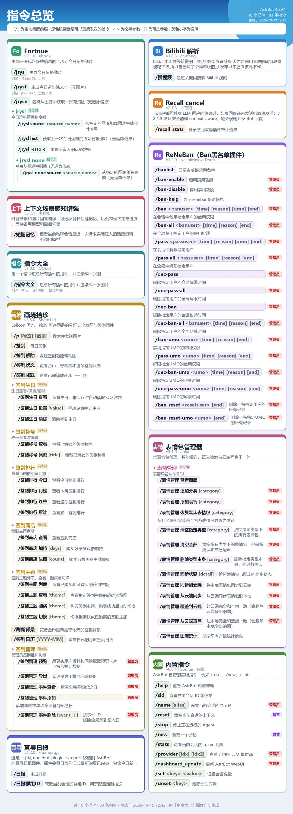

# 指令大全 · astrbot_plugin_command_help

[](LICENSE)

[](https://cloud.astrbot.app/plugin/AcceleratorYue/astrbot_plugin_command_help)

给 [AstrBot](https://github.com/AstrBotDevs/AstrBot) 加一个**统一的指令查询入口**：只注册一个指令，发送后自动抓取当前所有已加载插件的指令，在**本机渲染成一张卡片图**发出来。不依赖远端 T2I 服务，离线也能出图。

> 已在 [AstrBot 插件市场](https://cloud.astrbot.app/plugin/AcceleratorYue/astrbot_plugin_command_help) 上架，可直接在 WebUI 插件市场搜索「指令大全」安装。

```text
/指令大全        ← 别名：/帮助、/指令帮助、/指令列表
```

> 唤醒前缀跟随 AstrBot 的 `wake_prefix` 配置（如 `/`）；也可以 @机器人 后直接发 `指令大全`。



## 特性

- **一个指令**：`/指令大全`，不会和其他插件抢指令名。
- **自动汇总**：扫描所有已加载插件，每个插件一张卡片（名称 / 版本 / 作者 / 简介）。
- **完整指令信息**：指令组与子指令树状展开；显示 `[可选参数]`、`<必填参数>`；显示别名；管理员 / 群管指令带权限角标。
- **尊重运行时状态**：WebUI 里禁用或重命名的指令以实际生效的名称为准（优先走 AstrBot 官方指令管理接口）。
- **本地出图**：Pillow 直接绘制，不依赖任何在线渲染服务；自适应两栏卡片（可配 1~3 栏）。
- **轻量安全**：只读采集，不改动任何插件数据；图片写入 AstrBot 临时目录并自动清理旧图。

## 安装

### 方式一：插件市场（推荐）

1. 打开 AstrBot WebUI →「插件市场」。
2. 搜索「指令大全」（或插件 ID：`AcceleratorYue/astrbot_plugin_command_help`）。
3. 点击安装即可；插件市场会自动下载与当前版本匹配的压缩包。

### 方式二：WebUI 上传

1. 下载本仓库，压缩 `astrbot_plugin_command_help` 文件夹为 zip（或用 Releases 里的压缩包）。
2. 打开 AstrBot WebUI →「插件管理」→ 从本地安装/上传，选择该 zip。
3. 重载插件，发送 `/指令大全` 验证。

### 方式二：手动复制

把本目录放到 AstrBot 的插件目录下：

```text
<AstrBot 根目录>/data/plugins/astrbot_plugin_command_help/
```

目录内需包含 `main.py` 和 `metadata.yaml`（AstrBot 的标准插件结构），然后重载插件或重启 AstrBot。

### 依赖

只需要 `Pillow`（AstrBot 自带了 Pillow；若提示缺失，在插件管理里安装本插件的 `requirements.txt` 即可）。字体优先使用系统自带中文字体（Windows 的微软雅黑 / 黑体，Linux 的 Noto Sans CJK / 文泉驿），不需要随仓库分发字体。

## 使用与配置

发送 `/指令大全` 即可。可配置项（WebUI → 插件管理 → 指令大全）：

| 配置 | 默认 | 说明 |
| --- | --- | --- |
| `title` | 指令总览 | 图片顶部大标题 |
| `include_builtin` | 开 | 是否包含 AstrBot 内置指令（`/reset`、`/new`、`/stats` 等） |
| `include_admin_only` | 开 | 是否包含仅管理员/群管可用的指令（仍会带角标） |
| `show_aliases` | 开 | 是否显示指令别名 |
| `columns` | 2 | 卡片列数，1=单列长图，2=左右两栏，3=三栏紧凑 |
| `cache_seconds` | 30 | 图片缓存秒数，避免刷屏时反复渲染；0=每次重画 |
| `footer_note` | 空 | 页脚附加说明，例如「有问题找群主」 |

## 工作原理

采集分两条路，优先走官方接口：

1. **官方指令管理**（AstrBot 4.29+）：调用 `astrbot.core.star.command_management.list_commands()`。它已经处理了指令组 / 子指令 / 别名 / 权限，并且尊重 WebUI 里的指令重命名与禁用状态。
2. **兜底**：直接遍历 `astrbot.core.star.star_handler.star_handlers_registry`，自己解析 `CommandFilter` / `CommandGroupFilter`。官方接口不可用（旧版本、数据库未就绪等）时自动切换，并注意跳过子指令 handler，避免重复列出。

插件名 / 简介 / 版本来自各插件的 `metadata.yaml`（运行时优先用 `star_map` 中的元数据）。出图完全由 Pillow 在本地完成：通常 1 秒内即可生成一张包含十几个插件、上百条指令的图片。

## 已知限制

- 只收录通过 `@filter.command` / `@command_group` 注册的指令；用正则监听或只挂事件钩子的隐式触发不会出现在图里。
- 已禁用的插件与指令不会出现。
- 多个插件注册同名指令时，AstrBot 本身会让它们都触发，本插件只是如实列出。
- 内置指令只有英文 docstring，本插件内置了一份常用内置指令的中文说明；新版本新增的内置指令会回退显示原文。

## 开发与自测

`tests/test_offline_render.py` 会在本机 AstrBot 环境中把已安装插件导入当前进程，复刻注册表状态后验证：指令注册、metadata、插件类探测、配置 schema、权限过滤、官方接口归一化、端到端出图与缓存。

```bash
# 指定你本机 AstrBot 根目录（含 data/plugins 的那一层）
python tests/test_offline_render.py --astrbot-root "D:/QQbot/astrbot"

# 也可以用环境变量
ASTRBOT_ROOT=/path/to/astrbot python tests/test_offline_render.py
```

脚本会用真实插件的指令生成预览图 `_preview_command_help.png`（已加入 `.gitignore`）。

## 许可证

[MIT](LICENSE)
